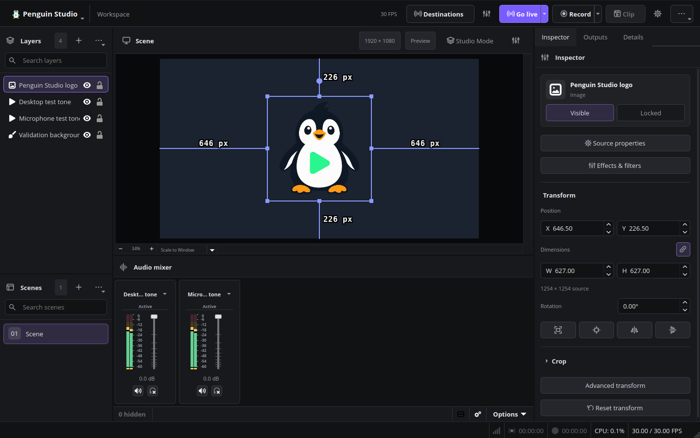

# Penguin Studio

**Your studio, every screen.** An independent Linux broadcasting application by SigmaCodez, built on OBS Studio.

Penguin Studio brings a redesigned production workspace, native multi-destination output controls, portrait output and platform connections to the OBS production engine. See the [architecture documentation](docs/ARCHITECTURE.md) for the engine baseline and technical details.

Actual Linux application capture with test media. See the [workspace guide](docs/WORKSPACE.md) for the controls and layout.

> Development preview. See [verification status](docs/VERIFICATION.md) for completed checks and remaining release tests, and [packaging](docs/PACKAGING.md) for development downloads and supported build targets. Validate your devices and streaming accounts before relying on this build for a live show.

## What is included

- A native production workspace with searchable layers and numbered scenes on the left, canvas in the center, a channel-strip audio mixer below, and tabbed inspector/output/details tools on the right. The top bar brings together destinations, live output, recording and replay clips.
- An editable inspector for source position, size, rotation, crop, visibility and locking, with undo/redo, source properties and filters. See the [workspace guide](docs/WORKSPACE.md).
- [Camera appearance](docs/CAMERA-EFFECTS.md): circle, oval and rounded-corner shapes, automatic local AI portrait removal, and green/blue screen options with adjustable thresholds.
- Original Penguin Studio logo, a complete dark control theme, English defaults and a separate `PenguinStudio` configuration directory.
- The upstream OBS capture, scene, recording, mixer, filter, plugin and translation infrastructure, including all 77 frontend locale files.
- A first-launch destination assistant, platform dashboard links and up to eight independently controlled RTMP(S) outputs.
- Landscape program output and a separate 1080 × 1920 portrait canvas with center crop or fit. Each destination has its own H.264/AAC encoding pipeline.
- Native Twitch device authorization and YouTube desktop authorization with PKCE. The **Stream details** dock can update titles through their APIs without an embedded browser, including in a Wayland session.
- Automatic NVIDIA NVENC and Linux VA-API H.264 selection for new simple-output profiles, the setup assistant and new destinations, with capability checks and software fallback. See [hardware encoding](docs/HARDWARE-ENCODING.md).
- Build definitions for Flatpak, Snap, DEB, RPM and AppImage, plus an Arch/AUR recipe, with a Linux CI workflow. See [AppImage and Arch installation](docs/APPIMAGE-AUR.md). See [packaging](docs/PACKAGING.md).

## Get started

**Current release: [Penguin Studio 0.4.3](https://github.com/SigmaCodez/PenguinStudio/releases/tag/penguin-v0.4.3)** — AppImage and Arch packaging, hardware encoding, browser sign-in and saved accounts.

**[Download Linux packages](https://github.com/SigmaCodez/PenguinStudio/releases)** — Ubuntu DEB, Fedora RPM, Flatpak, Snap, AppImage and an Arch/AUR recipe, with SHA-256 checksums.

**Ubuntu 26.04 / 26.04.1:** use a DEB built specifically for Ubuntu 26.04 or the
Flatpak bundle. Choose the package matching your distribution release. See [installation and troubleshooting](docs/PACKAGING.md#ubuntu-2604--26041-installation).

1. Install the Penguin Studio package for your system following the [installation guide](docs/PACKAGING.md).
2. Launch `penguin-studio`. Finish the hardware configuration and destination assistants. Twitch and YouTube sign-in is optional during setup.
3. Choose a platform, copy its RTMP(S) server and stream key from its creator dashboard, and choose landscape or portrait output.
4. Use **Destinations** to add further destinations. **Go live** starts all configured Penguin destinations; **End stream** stops them. The live button's menu also exposes OBS's separate primary stream action.
5. Open the arrow menu beside **Go live**, then choose **Stream details** to connect Twitch or YouTube for title updates. Official packages include the application configuration for browser sign-in with both providers; you do not need to enter client IDs. Use the searchable Twitch game and YouTube category lists, and **Docks → Twitch chat** for native chat. See [platform setup](docs/PLATFORMS.md).
6. Make a private test stream before a public broadcast. Check picture framing, sound, reconnects, CPU/GPU load, dropped frames and total upload bandwidth.

Twitch and YouTube sign-ins are saved in the system keyring and restored after restart when the keyring is available. **Disconnect** removes the saved account. The **Broadcast destinations** dock keeps stream keys in memory for the current session; they must be entered again after restart. Destination names, nonsecret server URLs and encoder choices are saved locally. Never put a stream key into a saved server URL. The separate **Settings → Stream** workflow can persist stream credentials in the local profile.

## Penguin Studio updates

New Penguin Studio versions are published on our [GitHub Releases page](https://github.com/SigmaCodez/PenguinStudio/releases), with release notes, Linux packages and SHA-256 checksums. Use **Help → Check for updates** to download and install a verified update on supported Ubuntu, Fedora and Flatpak installations. Automatic notifications announce newer versions. Stop all outputs before updating, confirm any system administrator prompt, then restart the app. Locally installed Snap bundles and AppImages require a manual package update. Arch installations use the updated recipe until an AUR listing is available. You can also close Penguin Studio and install the newer package for the same distribution release and format. See the [package guide](docs/PACKAGING.md) for format-specific instructions. Direct downloads do not require a source checkout.

Penguin Studio has its own version numbers and release schedule. Our GitHub Actions workflow builds and publishes the Linux packages when a new project version is released. These downloads are development previews; check the release notes and [verification status](docs/VERIFICATION.md) before updating a production setup.

## Scope and current limits

- Portrait currently crops or fits the program scene. Independently editable portrait scenes and a dual-preview editor remain future work.
- Encoders are selected per destination; hardware availability and simultaneous encoding limits depend on the GPU and drivers. Encoder sharing is not implemented.
- Twitch uses Penguin Studio’s bundled public application ID. Official YouTube packages include the publisher’s desktop application configuration. Google consent, test-user and channel eligibility restrictions still apply. No OBS Project application credentials are bundled.
- Kick, Facebook, TikTok and other RTMP(S) platforms use server/key setup. Native account login and title editing are not implemented for every provider; platform eligibility restrictions still apply.
- PipeWire capture and a working desktop portal are needed for Wayland screen sharing. Browser sources still depend on upstream CEF support and must be tested on the target compositor.
- Flatpak is the primary cross-distribution target. Native DEB/RPM builds target the distribution used to build them. Retained libobs paths mean native packages conflict with an existing native OBS installation.
- All existing OBS languages remain selectable. New Penguin dialogs have their own translations and English fallback; see [localization](docs/LOCALIZATION.md).

See [in-app updates](docs/UPDATES.md) for supported package formats and installation behavior.

## Contributing

For source checkout, builds and maintenance, see the [developer guide](CONTRIBUTING.md).

## Attribution and license

Penguin Studio is an independent application based on OBS Studio, not an official OBS Project or Meld Studio product. OBS Studio and the derived source are distributed under **GPL-2.0-or-later**; see [COPYING](COPYING), [AUTHORS](AUTHORS), and the original [OBS README](README.rst). Third-party components retain their individual licenses. Original Penguin contributions use the same GPL license. Redistributed binaries must be accompanied by the corresponding source and required notices.
