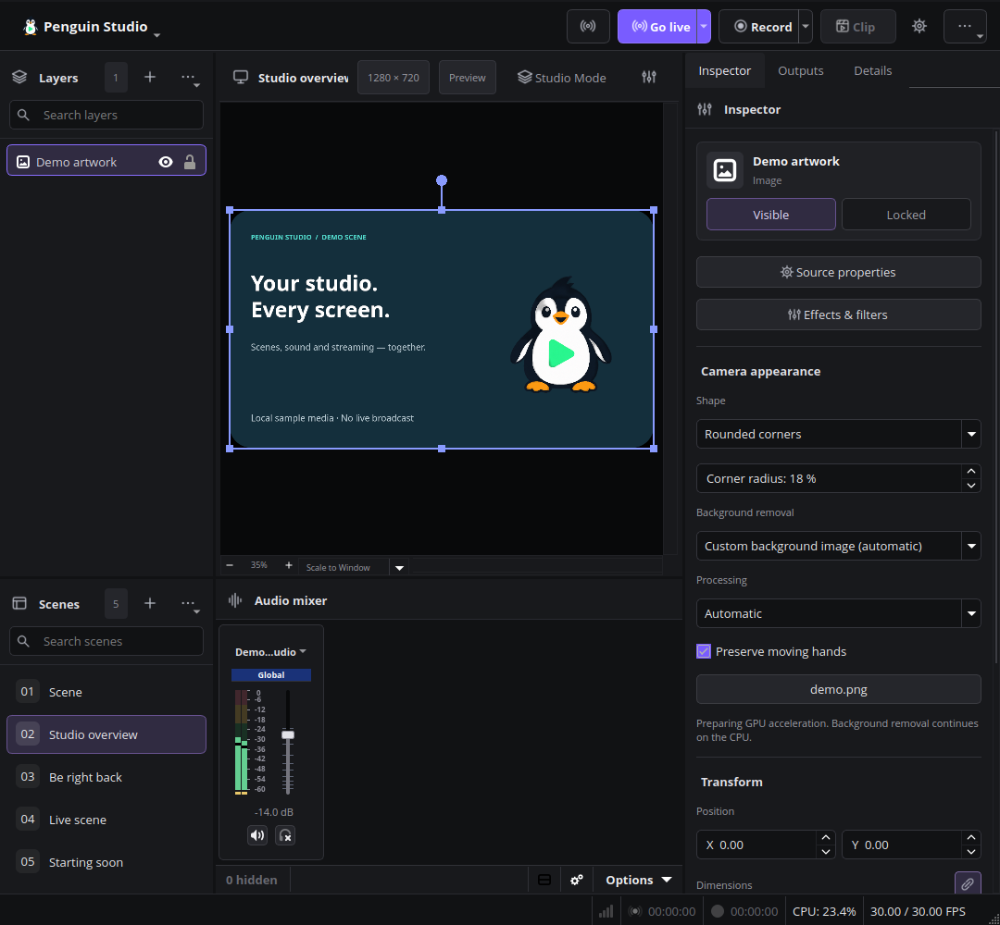

# Camera appearance

Select a camera or another video source and open **Camera appearance** in the
source Inspector. Use the Inspector to manage background removal together with camera shapes.
The Filters dialog exposes the individual appearance and matting filters.

- **Shape:** Rectangle, Circle, Oval, or Rounded corners. A circle keeps equal
  pixel radii; an oval fills the source's original aspect ratio. Rounded corners
  have an adjustable radius, expressed as a percentage of half the shorter edge.
- **Background:** Off, Automatic removal (local AI), Green screen, Blue screen,
  Blur background, or Custom background image.
  Shapes and background removal can be combined.
- **Key threshold:** Adjusts the green/blue screen separation. Lower values remove
  weaker color spill; higher values retain more of the original image.

Automatic mode uses **Robust Video Matting** through the bundled
[obs-backgroundremoval](https://github.com/royshil/obs-backgroundremoval) plugin.
It runs locally, with a bundled CPU backend using up to four physical CPU cores.
The **Processing** control offers Automatic, GPU and CPU. Automatic and GPU use
the optional compatible GPU runtime when available and fall back to CPU if
preparation or processing fails. GPU preparation runs in a separate helper; the
Inspector shows its status. CPU explicitly keeps inference on the CPU.

The optional Ubuntu 26.04 AMD add-on enables primary matting on the tested
RX 9070 XT; hand preservation continues on CPU. See [GPU setup](PACKAGING.md#optional-amd-camera-gpu-runtime).
Other package/hardware combinations retain CPU processing unless a compatible
runtime is provided. Existing scenes with an explicit CPU preference keep that
preference; select Automatic or GPU once to opt in.

No green screen, cloud account or particular GPU is required for CPU processing.
Camera frames stay on the device. The recurrent model retains information between frames to improve motion
continuity. Hair, transparent items, fast motion and difficult lighting can still
reduce accuracy; use even lighting and check the live preview before recording.

Penguin Studio applies matting to the full frame, then applies the selected shape.
The mask is calculated from the current frame before compositing, including the
first frame after enabling Automatic. It is not reused from the previous video tick.
A tagged companion filter is created for Automatic, Blur and Custom image and removed when switching to
Off, Green screen or Blue screen. Other user-added filters are retained.
The Inspector reports preparation, readiness or failure; errors remain in the
application log. Switch removal off and on to retry initialization.

Older scenes using the original MediaPipe filter remain readable. Select Automatic
in the Inspector (switch off and back on if necessary) to use the new backend.

Settings belong to the **source**, so they apply to every scene using that source.
They are saved with the scene collection and support Undo/Redo from the Inspector.
Other filters are retained. Selecting a new setting re-enables a camera appearance
filter that was disabled in the Filters dialog.

Official x86_64 Linux packages bundle the model, runtime and their license notices.
The Flatpak builder fetches the pinned runtime and OpenCV sources before entering
the offline build.
AppImage and the Arch binary package inherit the same files from the native package.
See `plugins/penguin-backgroundremoval/PROVENANCE.md` for the RVM plugin,
model licenses and exact upstream revision. The legacy model retains its notices
in `plugins/penguin-camera/data/MODEL-NOTICE.txt`.

Current English interface, captured from Penguin Studio 0.6.3. The sample artwork demonstrates rounded corners; it is not a webcam or an AI-removal quality demonstration.

## Validation

`test/penguin-camera-model.cpp` checks model tensor dimensions, real inference and
invalid input rejection. `test/penguin-camera-gui.cpp` exercises the installed
filter and Inspector with generated images in an isolated profile.
`test/penguin-camera-pixels.py` checks rendered alpha, circle versus oval geometry,
green and blue removal, restored unfiltered output, and serialized settings.
The first-frame regression renders a newly created matting filter before any video
tick and verifies that the raw background is already removed.
The DEB jobs run the GUI check before uploading a package. Native Wayland testing
uses the same helper with `QT_QPA_PLATFORM=wayland`.

## Background blur and custom images

The Camera appearance inspector adds **Blur background (automatic)** and
**Custom background image (automatic)**. Both use the existing local Robust Video
Matting model. Shape controls, including rounded corners, apply after background
processing so the whole camera composition has the selected outline.

Blur strength ranges from 1 to 20. Higher strengths require more GPU work. Custom
images are centered and cropped to fill the camera area without stretching.
Choose a PNG, JPEG or BMP image up to 8192 × 8192 pixels. Keep the image at
its selected path: the scene stores a reference, not an embedded copy. Missing
images leave the removed background transparent. Effect settings and the image
path participate in undo/redo and scene persistence.

Background processing stays on the device. As with removal, segmentation can
have soft edges around fast movement, hair or low-contrast subjects; these modes
do not promise perfect separation.

Custom-image compositing suppresses low-confidence alpha spill before blending
with the replacement image. The foreground color remains premultiplied and
intermediate alpha retains a soft transition. Background blur and transparent
removal are unchanged. This reduces weak background halos; it does not replace
the segmentation model or guarantee perfect edges under all lighting/motion.

## Preserve moving hands

Enable **Preserve moving hands** in the camera inspector after choosing automatic removal, background blur or a custom image. The option is off by default and is saved with the source, including undo/redo. It supplements RVM with a local body-skin segmentation model, processing the same frame before compositing. No camera images are uploaded.

This mode uses extra CPU capacity. A real Facecam movement test under Wayland retained both hands and was accepted as fluid by the tester. Rapid edges remain soft, and that 70-second motion recording logged one render-lag event and one encoder-skip event. Zero-loss motion performance is not guaranteed. Disable the option if your recording/stream statistics worsen. Unrelated filters and scenes without this option retain their existing inference mode.

The 0.6.3 RX 9070 XT test combined GPU primary matting with CPU hand preservation.
The user accepted the live result; the 1,504-frame recording reported no rendering
or encoding losses, decoded fully and shut down cleanly. This does not guarantee
perfect segmentation or zero losses on other scenes. See [GPU validation](validation/camera-gpu-0.6.3.md).
