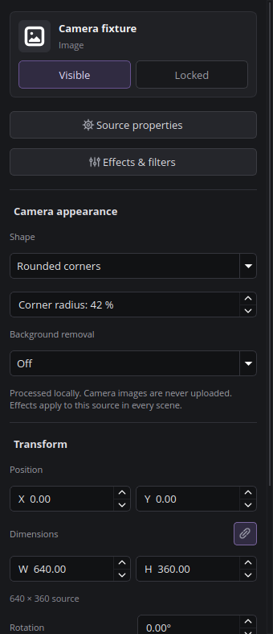

# Camera appearance

Select a camera or another video source and open **Camera appearance** in the
source Inspector. The same controls are available in **Filters → Camera appearance**.

- **Shape:** Rectangle, Circle, Oval, or Rounded corners. A circle keeps equal
  pixel radii; an oval fills the source's original aspect ratio. Rounded corners
  have an adjustable radius, expressed as a percentage of half the shorter edge.
- **Background removal:** Off, Automatic (local AI), Green screen, or Blue screen.
  Shapes and background removal can be combined.
- **Key threshold:** Adjusts the green/blue screen separation. Lower values remove
  weaker color spill; higher values retain more of the original image.

The automatic mode uses a bundled MediaPipe Selfie Segmentation model and the CPU
execution provider in ONNX Runtime. It does not require a green screen, a model
download, a cloud account, or a particular GPU. Camera frames stay on the device.
It targets people, rather than arbitrary objects; hair, transparent items,
motion, unusual lighting and clothing can reduce accuracy. Use even lighting
and a clear separation between the person and the background for best results.

The model processes up to 15 masks per second using at most two inference threads.
Video continues at the configured frame rate with the latest completed mask.
The Inspector reports preparation, readiness or failure. If inference fails,
the original background remains visible; shapes continue working. Switch removal
off and on to retry. The error is also recorded in the application log.

Settings belong to the **source**, so they apply to every scene using that source.
They are saved with the scene collection and support Undo/Redo from the Inspector.
Other filters are retained. Selecting a new setting re-enables a camera appearance
filter that was disabled in the Filters dialog.

Official x86_64 Linux packages bundle the model, runtime and their license notices.
The Flatpak builder fetches the pinned runtime before entering the offline build.
AppImage and the Arch binary package inherit the same files from the native package.
See `plugins/penguin-camera/data/MODEL-NOTICE.txt` for attribution and exact versions.

## Validation

`test/penguin-camera-model.cpp` checks model tensor dimensions, real inference and
invalid input rejection. `test/penguin-camera-gui.cpp` exercises the installed
filter and Inspector with generated images in an isolated profile.
`test/penguin-camera-pixels.py` checks rendered alpha, circle versus oval geometry,
green and blue removal, restored unfiltered output, and serialized settings.
The DEB jobs run the GUI check before uploading a package. Native Wayland testing
uses the same helper with `QT_QPA_PLATFORM=wayland`.
