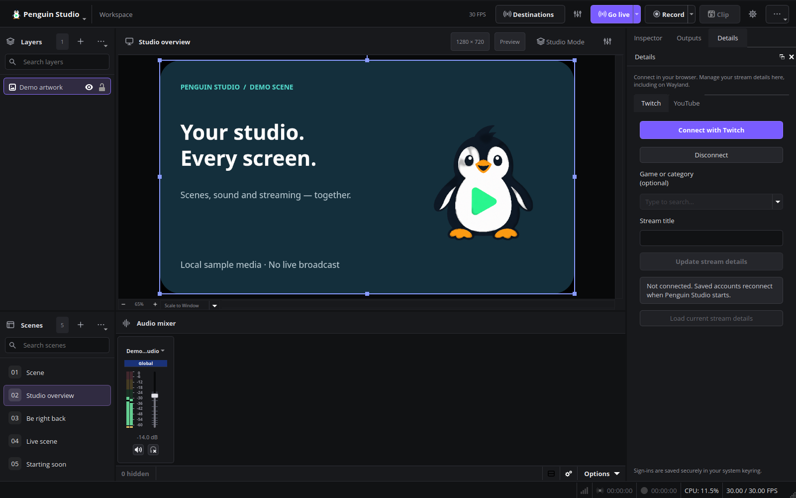

# Platform connections and Wayland

Current 0.6.1 interface before sign-in. This preview contains no account information.

## Twitch

1. Open **Docks → Stream details → Twitch** and select **Connect with Twitch**.
2. Penguin opens the official Twitch activation page in your system browser. Enter the displayed device code and authorize the application. No Twitch password is entered into Penguin Studio.
3. Use **Load current stream details** to retrieve the current title and category name, or enter a title and select an optional category from the searchable game list, then select **Update stream details**.
4. Open **Docks → Stream chat → Twitch**. The native dock reads and sends messages in the connected account's channel on Wayland as well as X11. It follows chat deletion/clear events and reconnects after connection loss. Right-click messages for moderation, open Chat settings for chat modes, or use Chat participants for connected/recent chatters and session bans. The implementation displays plain text, including emote names; it does not embed Twitch's web dashboard or render third-party emote extensions.

The maintainer's public Twitch application ID is bundled with Penguin Studio. The application must remain registered with client type **Public**; no client secret is embedded. Device authorization requests `channel:manage:broadcast`, `user:read:chat`, `user:write:chat`, `moderator:read:chatters`, `moderator:manage:chat_messages`, `moderator:manage:banned_users` and `moderator:manage:chat_settings`. Existing accounts should reconnect once to grant the new moderation permissions. The module validates tokens after connection and periodically while connected, and refreshes them before expiration. Access tokens and chat history remain in memory. Refresh tokens are saved in the system keyring and exchanged for a new access token on startup. Rotated refresh tokens replace the saved value. Disconnect disables automatic sign-in and deletes the saved credentials. Revoking the application itself is done in Twitch account settings.

The chat uses Twitch EventSub WebSockets and the Send Chat Message API, with bounded history and authenticated HTTPS requests that do not follow redirects. An API failure is shown in the dock; it never falls back to sending unauthenticated messages. This login manages chat and metadata; broadcast destinations and their stream keys remain a separate setup step.

References: [device grant](https://dev.twitch.tv/docs/authentication/getting-tokens-oauth/#device-code-grant-flow), [channel update API](https://dev.twitch.tv/docs/api/reference/#modify-channel-information), [chat authentication](https://dev.twitch.tv/docs/chat/authenticating), [WebSocket lifecycle](https://dev.twitch.tv/docs/eventsub/handling-websocket-events/).

## YouTube

1. Open **Docks → Stream details → YouTube** and select **Connect with YouTube**.
2. Complete account selection and authorization in your system browser. Penguin restores saved sign-ins from the system keyring on subsequent starts.
3. Create or schedule a broadcast in [YouTube Studio](https://studio.youtube.com), load your broadcasts in Penguin, select one, and update its title.
4. Open **Docks → Stream chat → YouTube** and load an active broadcast to read, send and moderate its chat. **People / moderation** shows recent chatters and bans created in this session. See the [chat guide](CHAT.md) for permissions, viewer counts, polling and platform limitations.

Publisher-configured packages use Penguin Studio's Google Desktop app. Users do not
need to register their own Google application or enter client credentials. Maintainers
and custom builds can use **Advanced application settings**; existing locally
configured accounts retain their client ID and saved credentials. A build without
publisher configuration or a locally configured client displays an explanatory
message instead of opening a broken Google authorization URL.

The system-browser flow uses a loopback callback bound to `127.0.0.1` on an ephemeral
port, random state and PKCE. Desktop client credentials and refresh tokens for saved
accounts remain in the system keyring.

The implementation updates the video's title and an optionally selected video category while preserving its description, tags and language fields. Categories are loaded from YouTube's videoCategories API for the desktop locale's region (US fallback) and filtered as you type. Only assignable categories are offered. The public Data API does not expose a writable individual game-title selector; choose specific games in YouTube Studio. Leaving the category field empty preserves the video's existing category. It does not create broadcasts, enable live streaming on an account, or bypass Google's consent/API verification process. See [Google desktop OAuth](https://developers.google.com/identity/protocols/oauth2/native-app) and [videos.update](https://developers.google.com/youtube/v3/docs/videos/update).

### Maintainer setup: Google Cloud and package configuration

1. Select or create a project for Penguin Studio in [Google Cloud Console](https://console.cloud.google.com/).
2. Under **APIs & Services → Library**, enable **YouTube Data API v3** in that project.
3. Open **Google Auth Platform**. Configure **Branding** with the application name
   `Penguin Studio` and an owner-controlled support/contact email. Choose **External**
   audience for accounts outside a single Google Workspace organization. For initial
   testing, keep publishing status **Testing** and add the Google account that owns
   the intended YouTube channel as a test user.
4. Under **Data Access**, add `https://www.googleapis.com/auth/youtube.force-ssl`.
   This is the scope requested by the current metadata editor and live-chat tools; Google controls the
   permissions described on its consent screen. The read-only validation below does
   not send metadata changes despite requesting the editor's scope.
5. Under **Clients**, create an OAuth client of type **Desktop app**, named
   `Penguin Studio Desktop`. An API key, service account, or Web application client
   is not a replacement. Penguin uses a loopback callback with an ephemeral port;
   do not configure a fixed web callback URL for this desktop client.
6. For a local maintainer test, open **Advanced application settings** and enter the
   client ID and the client secret supplied by Google directly in the YouTube dock. Keep downloaded credential JSON outside the repository. Complete
   account selection and authorization only on Google's official browser pages.

For official Linux packages, configure GitHub Actions repository secrets
`PENGUIN_YOUTUBE_CLIENT_ID` and `PENGUIN_YOUTUBE_CLIENT_SECRET` from this **Desktop app**.
Each package job runs `scripts/packaging/configure-youtube.py` before building. A
published release requires both values; development builds may omit them. The
script generates an ignored header in the source tree so DEB, RPM, Flatpak and Snap
use the same application identity. Never supply a Web application secret or user
tokens: desktop credentials are extractable from distributed binaries, even when
injected through CI secrets. Google production/verification requirements still
apply before general distribution. For local packaging, run the same script with
those environment variables set before invoking the package builder.

For a read-only live check, verify that assignable video categories load, type to
filter them, and verify the system-keyring saved-sign-in message. Close Penguin
Studio normally, reopen it with the same configuration, and confirm that categories
load again without another authorization. Do not click **Disconnect** between the
two runs; that intentionally removes saved credentials. No broadcast is required
for the category endpoint. Broadcast listing may require channel/live eligibility;
an empty list or lack of live eligibility must be distinguished from failed OAuth.

For **External / Testing**, Google normally expires refresh tokens after seven
days when requesting YouTube scopes. Secure local storage does not override this
policy. A successful immediate restart does not certify indefinite access. Public
distribution may require Google's verification process and production consent
configuration; changing publishing status alone is not evidence of approval.
See [desktop OAuth](https://developers.google.com/identity/protocols/oauth2/native-app),
[consent configuration](https://developers.google.com/workspace/guides/configure-oauth-consent),
and [refresh-token expiration](https://developers.google.com/identity/protocols/oauth2#expiration).

## Other destinations

The first-launch wizard includes Twitch, YouTube, Kick, Facebook Live, TikTok LIVE and custom RTMP(S). Open the selected creator dashboard, then enter the server and stream key provided for that account. Some providers require access approval or account eligibility before exposing stream keys. No universal OAuth or metadata API exists across all these services.

## Wayland

Platform metadata controls and the native Twitch/YouTube chat tabs use Qt Network/WebSockets and system-browser authorization, so they do not rely on the embedded Twitch browser panel that OBS disables under Wayland. Screen capture continues to use OBS's PipeWire source and the desktop's screen-sharing portal. Install a portal backend appropriate to the desktop (for example GNOME, KDE or wlroots). Test the actual compositor, graphics driver and sandbox package being shipped.

## Secret handling

Do not commit tokens, stream keys or client secrets. The **Stream details** dock stores refresh tokens and required desktop client secrets through QtKeychain in the system keyring (Secret Service or KWallet). Plaintext fallback is disabled. Public client IDs and an automatic-sign-in preference remain in local settings. If the keyring is locked or unavailable, an explicit message explains that persistence failed; the current connection can still be used. Disconnect disables future automatic sign-in even if keyring deletion fails, and allows retrying deletion. Closing Penguin Studio does not delete a successfully saved account. Stored accounts are isolated by application configuration path and provider.

Flatpak grants access to Secret Service and KWallet. A locally installed strict Snap may require connecting its password-manager-service interface with `sudo snap connect penguin-studio:password-manager-service`. No keyring password is collected by Penguin Studio.

The **Broadcast destinations** dock still keeps stream keys session-only. The inherited **Settings → Stream** workflow is separate and can persist stream credentials in the local profile, including `service.json`.

## Optional sign-in during setup

The first-start connection assistant offers Twitch and YouTube sign-in, with an explicit option to skip by continuing. The destination configuration page also has an optional account button. These open the same native account controls as the Stream details dock, so there is one account state per provider. Closing the account dialog returns to the wizard. Both providers use browser authorization. Official packages include the required application configuration; custom YouTube builds can use Advanced application settings. Account authorization does not itself configure a video-stream destination or start broadcasting.
