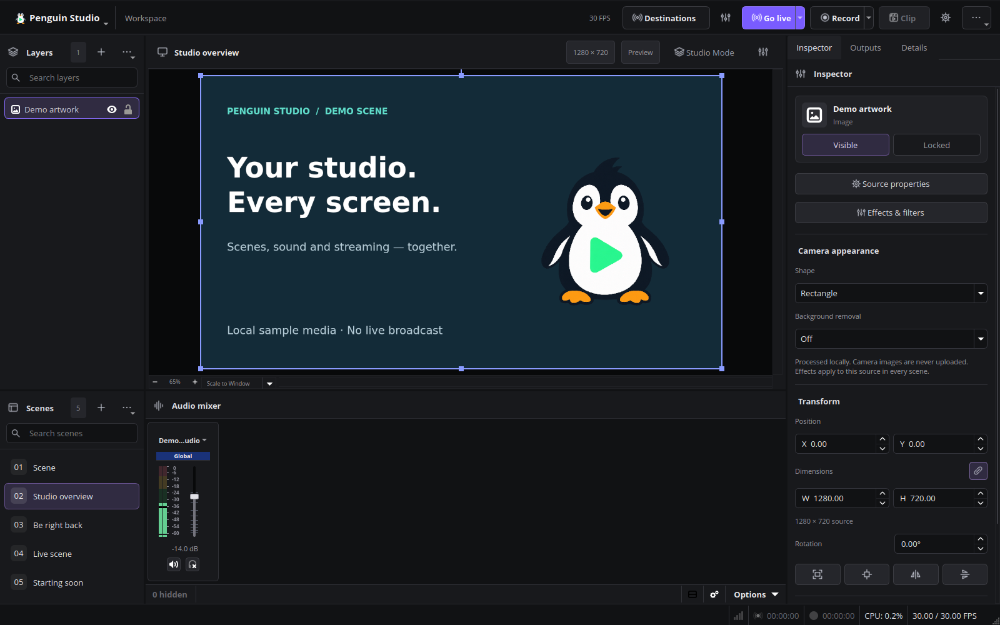

# Penguin Studio workspace

Penguin Studio combines Qt Quick navigation with native Qt source controls, a large preview, audio meters and a context sidebar.

Current previews are being refreshed for the 0.7.2 candidate before publication. All published previews use an isolated English profile and synthetic media.

## Start a session

1. Choose a scene in the left-hand **Scenes** list. Search filters the list without changing the scene collection. **Manage** opens scene management.
2. Add a camera, image, capture or other source in **Sources** below the preview.
3. Select **Edit selected source** to adjust its position, size, crop and effects.
4. Check the **Audio mixer** and record a short test before going live.

**Streaming channels**, **Title & category** and **Live chat** open the corresponding right-hand panel. They reuse the native output and platform controllers. Duplicate toolbar shortcuts are hidden while the simplified workspace is active.

## Production controls

- **Penguin Studio** opens searchable application commands. The existing actions and keyboard shortcuts remain available.
- **Settings** opens searchable settings navigation. Forms retain their native validation and save/cancel behavior.
- **Go live** starts configured destinations through their validated controller. With no destinations configured, it opens setup. **End stream** stops those outputs.
- **Record** starts the recording controller. Its menu offers pause/resume when supported by the recording mode.
- **Clip** saves the active replay buffer. Configure and start the replay buffer before saving clips.
- **Advanced** groups replay-buffer, virtual-camera, studio-mode and other advanced controls, including the separate primary-stream action. Its credentials remain separate from Penguin destinations.

The bottom status bar shows active recording/live timers, CPU usage and frame rate. Supported Linux drivers also supply utilization of the GPU rendering the workspace. This is whole-device load; a dash means unavailable data, not zero utilization. Inactive timers stay hidden and recording pause is explicit.

## Arrange the workspace

**Workspace layout** opens arrangement and restoration actions. Scene collections, profiles and sources are preserved. The previous arrangement is retained when the simplified layout is first applied; subsequent launches restore the saved layout. Docks can still be moved and resized.

The Inspector edits real source transforms and participates in undo/redo. Properties, filters and advanced transform controls remain available. Multiple selection prompts you to choose one source for numeric inspection.

Navigation has a visible keyboard focus indicator and supports Tab, Enter and Escape. Text sizing follows the interface font setting, with scrolling for longer forms. The new navigation currently uses English labels; native dialogs and platform forms retain their existing translations.

## Scope

Portrait destinations currently crop or fit the program scene; there is no independently editable second portrait scene. GPU availability, live-provider verification and device testing retain the limits documented in [VERIFICATION.md](VERIFICATION.md).
